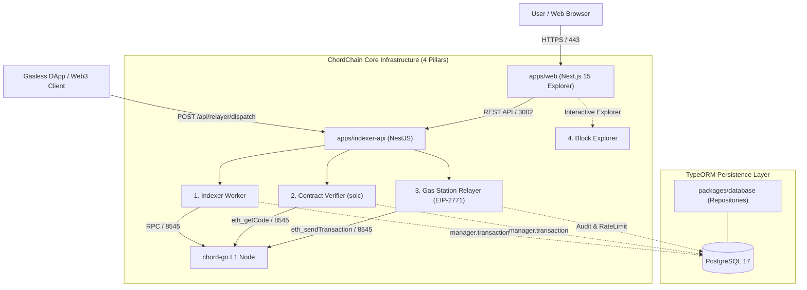

# ChordChain Infrastructure (`chordchain-infra`)

> **Full-Stack Enterprise Infrastructure Suite for CHORD L1: Explorer, Indexer, Verifier & AvaCloud-Style Gas Station Relayer**

[](https://nextjs.org)
[](https://nestjs.com)
[](https://typeorm.io)
[](https://eips.ethereum.org/EIPS/eip-2771)
[](https://opensource.org/licenses/MIT)

---

## 1. 개요 (Overview)

`chordchain-infra`는 L1 고성능 체인 **CHORD**의 엔터프라이즈 운영을 뒷받침하는 4대 핵심 인프라 플랫폼입니다:
1. **Block Explorer (`apps/web`)**: Next.js 15 기반 실시간 블록, 트랜잭션, 계정 및 256-depth ZK SMT 시각화기
2. **Real-time Event Indexer (`apps/indexer-api/src/indexer`)**: 온체인 이벤트 및 상태 전이 실시간 인덱싱 워커
3. **Smart Contract Verifier (`apps/indexer-api/src/verifier`)**: solc 표준 JSON-input 및 EVM 2바이트 CBOR 메타데이터 트렁케이트 무결성 검증 엔진
4. **Gas Station Relayer (`apps/indexer-api/src/relayer`)**: AvaCloud 스타일의 EIP-2771 메타 트랜잭션 가스 대납(Gas Sponsorship) 릴레이어

기존 `sentinel` 및 `freddie-forge`의 검증된 엔터프라이즈 아키텍처 패턴을 계승합니다:
- **TypeORM 트랜잭션 전파 패턴**: `private repo(entityManager?: EntityManager)` 패턴을 통해 비즈니스 로직에서 복수 작업을 단일 트랜잭션으로 원자적(Atomic) 처리
- **시크릿 수명 최소화 (`withSecretBuffer`)**: 시크릿 파일을 읽은 즉시 복사본을 생성하고 원본/복사본 모두 `zero-fill` 소거
- **AvaCloud-스타일 가스 스폰서십 정책**: 화이트리스트 컨트랙트 타깃팅, 시간당/일당 Rate Limit, EIP-712 무가스(Gasless) 트랜잭션 실행

---

## 2. 아키텍처 다이어그램 (Architecture)



---

## 3. 모노레포 패키지 구조 (Package Structure)

```text
chordchain-infra/
├── apps/
│   ├── web/                    # Next.js 15 탐색기 프론트엔드 (Port :3001)
│   │   ├── app/                # 대시보드, 블록/트랜잭션 조회
│   │   ├── app/zk-visualizer/  # 256-depth ZK SMT 인터랙티브 트리 시각화기
│   │   └── app/verify/         # 스마트 컨트랙트 소스코드 검증 및 공개 등록
│   └── indexer-api/            # NestJS 기반 체인 인덱서, 검증기 & 가스 스테이션 (Port :3002)
│       ├── src/indexer/        # 8545 RPC 블록/트랜잭션 이벤트 구독 워커
│       ├── src/verifier/       # solc 컴파일러 & CBOR 메타데이터 트렁케이트 검증기
│       ├── src/relayer/        # AvaCloud-스타일 EIP-2771 Gas Station Relayer
│       │   ├── relayer.service.ts     # EIP-712 서명 검증, 스폰서십 정책, 온체인 디스패치
│       │   ├── relayer.controller.ts  # POST /api/relayer/dispatch, GET /api/relayer/status
│       │   └── relayer.module.ts      # Relayer 의존성 주입 모듈
│       └── src/api/            # REST 컨트롤러 (/api/stats, /api/blocks 등)
├── packages/
│   ├── database/               # TypeORM 기반 데이터베이스 패키지 (sentinel 패턴)
│   │   ├── src/entities/       # Block, Transaction, Contract, ContractVerification
│   │   └── src/repositories/   # this.repo(manager?) 패턴 전용 리포지토리
│   ├── vault/                  # withSecretBuffer (메모리 zero-fill 소거) 패턴
│   └── types/                  # 공용 DTO 및 인터페이스 (Relayer, Verification 등)
├── docker/
│   └── docker-compose.yml      # PostgreSQL 17 컨테이너 설정
├── package.json                # Turborepo / npm workspaces ("chordchain-infra")
├── turbo.json                  # 빌드 파이프라인 캐시 설정
└── README.md
```

---

## 4. 로컬 실행 가이드 (Getting Started)

### 4.1 의존성 설치
```bash
npm install
```

### 4.2 DB 기동 (Docker)
```bash
docker-compose -f docker/docker-compose.yml up -d
```

### 4.3 개발 서버 실행 (병렬 기동)
```bash
# 전체 앱 병렬 실행 (Web :3001, Indexer-API :3002)
npm run dev

# 또는 개별 실행
npm run dev:api    # apps/indexer-api 실행
npm run dev:web    # apps/web 실행
```

### 4.4 검증 및 단위/통합 테스트
```bash
# 전체 검증기 및 가스 스테이션 릴레이어 테스트 실행
npm test -w apps/indexer-api
```

---

## 5. 라이선스 (License)
MIT License.
